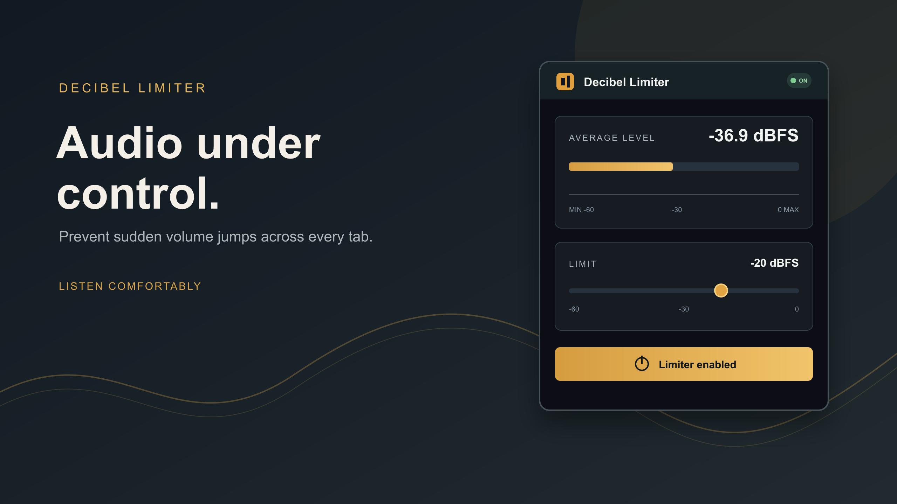
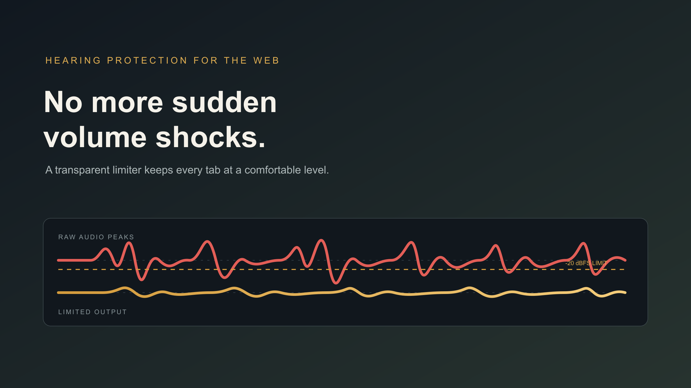
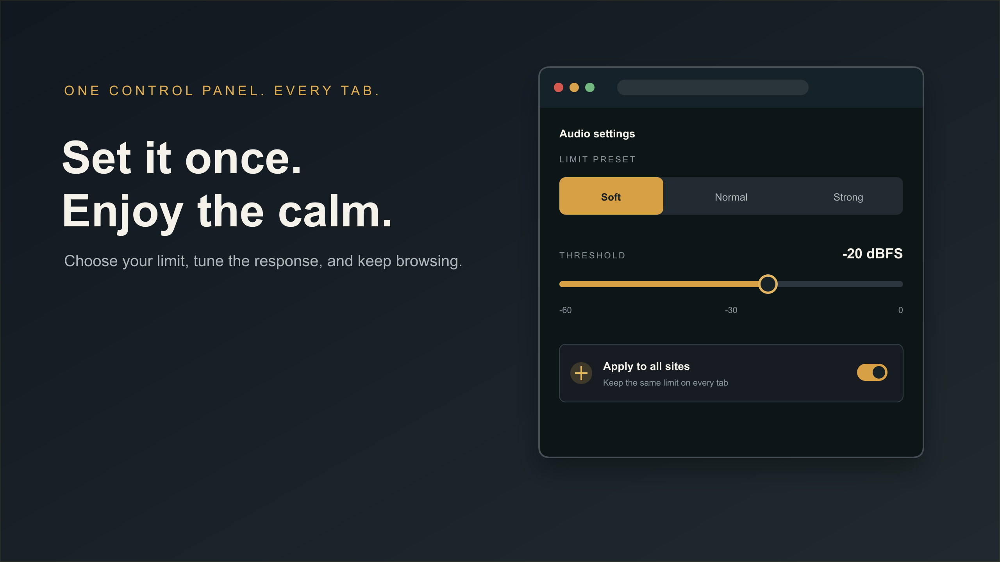

# 🔊 Decibel Limiter

<div align="center">


**Protect your hearing and control audio volume automatically in your browser**

[](https://chrome.google.com/webstore/detail/jhdflfacjalpcajleapijmclnbilnjlh)
[](LICENSE)
[](CONTRIBUTING.md)


[Features](#-key-features) • [Installation](#-installation) • [Usage](#-usage) • [How It Works](#-how-it-works) • [Contributing](#-contributing)

</div>

---

## 📝 Overview

**Decibel Limiter** is a powerful browser extension that automatically monitors and limits audio volume across all your browser tabs. Designed to protect your hearing and provide a consistent listening experience, it prevents sudden loud sounds from startling you or causing discomfort while browsing.

Perfect for night browsing, shared workspaces, or anyone who values their hearing health.



<div align="center">




</div>

## ✨ Key Features

### 🎯 Core Functionality
- **🔄 Real Lookahead Limiting** - Buffers a few milliseconds of audio so gain is already ducked *before* a loud transient reaches your speakers
- **🏆 Best quality by default** - Tab capture path so peaks are stopped before you hear them (Fullscreen-friendly fallback available)
- **🌙 Scenario presets** - Night, Balanced, Social, Music — plus optional leveling (off for Music)
- **🔖 Per-site memory** - Remembers settings per domain (or apply one setting to all sites)
- **📊 Live Audio Monitoring** - Meter + live gain reduction readout
- **🎚️ Customizable Threshold** - Fine-tune between 0 and -60 dBFS in Settings

### 🎨 User Experience
- **📈 Clear interface** - Scenarios first; advanced limiter controls in Settings
- **⌨️ Shortcuts** - Alt+Shift+D toggle, Alt+Shift+S cycle scenario
- **⚡ Lightweight & Fast** - AudioWorklet on the audio thread
- **🔒 Privacy-Focused** - All processing local, no data collection, export/import settings

### 🌐 Compatibility
- **Popular Streaming Sites** - Works flawlessly with Netflix, YouTube, Spotify, and more
- **Shadow DOM Support** - Advanced detection for complex web applications
- **Dynamic Content** - Automatically detects media elements added after page load

## 🎯 Use Cases

| Scenario | Benefit |
|----------|---------|
| 👂 **Hearing Protection** | Prevent hearing damage from unexpected loud sounds |
| 🌃 **Night Browsing** | Watch content late without disturbing others |
| 🏢 **Work Environments** | Avoid embarrassing volume spikes in shared spaces |
| 📊 **Volume Normalization** | Consistent audio levels across different websites |
| 👨‍👩‍👧‍👦 **Parental Control** | Protect children's hearing with maximum volume limits |
| 🎮 **Gaming & Streaming** | Prevent audio peaks during intense moments |

## 🔍 How It Works

Decibel Limiter leverages the **Web Audio API** to provide intelligent, real-time audio control:

```
1. 🔎 Detection Phase
   └─> Scans page for <audio> and <video> elements
       └─> Includes Shadow DOM elements (Netflix, etc.)
           └─> Monitors for dynamically added media

2. 📊 Analysis Phase
   └─> AnalyserNode measures volume in real-time
       └─> Converts to dBFS (decibels relative to full scale)
           └─> Compares against user-defined threshold

3. 🎚️ Lookahead Limiting Phase
   └─> Buffers a few ms of audio; if an upcoming block exceeds the ceiling, gain drops immediately — before it's heard
       └─> Below the ceiling? Gain restores gradually (release speed set by preset)
           └─> A safety compressor after the computed gain guards against any remaining clipping
               └─> Maintains natural listening experience, without ever sounding louder than your limit

4. 💾 Persistence
   └─> Settings saved per-tab by default (cleared when the tab closes)
       └─> Or turn on "Apply to all sites" to save one setting globally and push it to every tab/domain
           └─> Global settings persist across browser restarts
```

### Technical Architecture

- **Client-Side Processing** - All audio analysis happens in your browser
- **Zero External Requests** - No data sent to servers, completely private
- **Mutation Observers** - Detect new media elements dynamically
- **Performance Optimized** - Efficient algorithms minimize CPU usage
- **Cross-Site Compatible** - Works with modern web standards

- ## 📋 Requirements

- **Browser**: Chromium-based browser version 88 or higher
- **Permissions**: 
  - Active tab access (to detect and control media)
  - Local storage (to save preferences)

## 📥 Installation

### From the browser extension store (Recommended)
1. Visit the extension store page (link provided in the project header)
2. Click **"Add to browser"**
3. Confirm the installation

### Manual Installation (Development)
1. Download or clone this repository
   ```bash
   git clone https://github.com/yourusername/decibel-limiter.git
   ```
2. Open your browser and navigate to `chrome://extensions/`
3. Enable **"Developer mode"** (toggle in top-right corner)
4. Click **"Load unpacked"**
5. Select the extension folder

## 🚀 Usage

### Quick Start

1. **Click** the Decibel Limiter icon in your browser toolbar
2. **Adjust** the threshold slider to your preferred limit (dBFS)
3. **Enable** the limiter by clicking the activation button
4. **Monitor** the real-time volume meter as you browse

### Understanding dBFS Values

| dBFS Range | Description | Recommended For |
|------------|-------------|-----------------|
| **0 to -10** | Very loud, minimal limiting | Noisy environments |
| **-10 to -20** | Moderate limiting | General browsing |
| **-20 to -30** | Significant limiting | Night browsing |
| **-30 to -60** | Heavy limiting | Sensitive environments |

### Pro Tips

- 💡 Start with **-15 dBFS** and adjust based on your comfort
- 🎵 Different content types may need different thresholds
- 🔄 The extension remembers settings per-tab automatically
- 🎯 Green indicator means limiter is active and working

## ❓ Troubleshooting

### Common Issues and Solutions

<details>
<summary><strong>Extension doesn't detect audio</strong></summary>

- Ensure audio is actually playing (not paused)
- Refresh the page after enabling the extension
- Check that the tab isn't muted
- Try closing and reopening the popup
</details>

<details>
<summary><strong>Limiting doesn't work on specific sites</strong></summary>

- Some sites use proprietary audio systems (rare)
- Try refreshing the page with the extension already enabled
- Check browser console for any error messages
- Report unsupported sites via GitHub Issues
</details>

<details>
<summary><strong>Audio sounds distorted or cuts out</strong></summary>

- Increase the threshold (move slider closer to 0 dBFS)
- The audio may naturally be very dynamic
- Try adjusting by -5 dBFS increments until comfortable
</details>

<details>
<summary><strong>High CPU usage</strong></summary>

- This is rare but can happen with multiple tabs
- Consider enabling only on tabs that need limiting
- Close unused tabs with active audio
</details>

## 🔒 Privacy & Security

We take your privacy seriously:

- ✅ **No Data Collection** - Zero telemetry or analytics
- ✅ **No External Requests** - Everything runs locally
- ✅ **No Account Required** - Works immediately after installation
- ✅ **Open Source** - Code available for audit
- ✅ **Minimal Permissions** - Only requests what's necessary
- ✅ **Offline Capable** - No internet required after installation

## 🛠️ Development

### Tech Stack

- **Core**: Vanilla JavaScript (ES6+)
- **APIs**: Web Audio API (AudioWorklet, DynamicsCompressorNode), browser extensions APIs (Chromium-compatible)
- **UI**: HTML5, CSS3 (studio-style dark theme)
- **Storage**: browser storage APIs (Chromium-compatible)

### Project Structure

```
decibel-limiter/
├── extension/             # Everything that ships in the packaged extension
│   ├── manifest.json      # Extension configuration
│   ├── popup.html         # Popup UI
│   ├── popup.css
│   ├── offscreen.html
│   ├── js/
│   │   ├── background/    # Service worker (main, storage, capture)
│   │   ├── popup/         # Popup UI modules
│   │   ├── content.js
│   │   ├── offscreen.js
│   │   ├── presets.js
│   │   ├── limiter-processor.js
│   ├── icons/             # Extension icons
│   └── _locales/          # i18n messages
├── tests/                 # Dev-only checks, not shipped in the extension
│   ├── limiter-processor.test.js
│   └── test-audio.html
├── build.ps1              # Zips extension/ into a store-ready package
└── img/                   # Documentation images
```

### Building from Source

```bash
# Clone the repository
git clone https://github.com/yourusername/decibel-limiter.git

# Navigate to directory
cd decibel-limiter

# Load in browser as unpacked extension
# No build step required - pure vanilla JS!
```

## 👥 Contributing

We welcome contributions from the community! Here's how you can help:

### Ways to Contribute

- 🐛 **Report Bugs** - Found an issue? Let us know!
- 💡 **Suggest Features** - Have an idea? We'd love to hear it
- 📝 **Improve Documentation** - Help others understand the project
- 🔧 **Submit Pull Requests** - Code contributions are appreciated

### Contribution Process

1. **Fork** the repository
2. **Create** a feature branch
   ```bash
   git checkout -b feature/amazing-feature
   ```
3. **Commit** your changes
   ```bash
   git commit -m 'Add amazing feature'
   ```
4. **Push** to your branch
   ```bash
   git push origin feature/amazing-feature
   ```
5. **Open** a Pull Request

### Development Guidelines

- Follow existing code style and conventions
- Test thoroughly across different websites
- Update documentation for new features
- Keep commits focused and well-described

## 🗺️ Roadmap

- [x] Support for more streaming platforms
- [x] Multi-language support
- [x] Compression/leveling options (scenario-based)
- [x] Export/import settings
- [x] Audio presets for different scenarios (Night / Balanced / Social / Music)
- [x] Keyboard shortcuts
- [x] Best-quality (enhanced) path as default
- [x] Per-domain memory
- [ ] More locales / parental lock (if demanded)

## 📊 Statistics

View live statistics for this extension:


## 📄 License

This project is licensed under the **MIT License** - see the [LICENSE](LICENSE) file for details.

```
MIT License - Copyright (c) 2024
Permission is hereby granted, free of charge, to any person obtaining a copy...
```

## 🙏 Acknowledgments

- Built with the powerful **Web Audio API**
- Inspired by the need for better audio control on the web
- Thanks to all contributors and users for feedback and support

## 📞 Support & Contact

Need help or want to get in touch?

- 🐛 **Issues**: [GitHub Issues](https://github.com/yourusername/decibel-limiter/issues)
- 💬 **Discussions**: [GitHub Discussions](https://github.com/yourusername/decibel-limiter/discussions)
- ⭐ **Rate Us**: [Browser Web Store](https://chrome.google.com/webstore/detail/jhdflfacjalpcajleapijmclnbilnjlh)

---

<div align="center">

**Made with ❤️ for a better, safer browsing experience**

If this extension helped you, consider giving it a ⭐ on GitHub!

[⬆ Back to Top](#-decibel-limiter)

</div>
