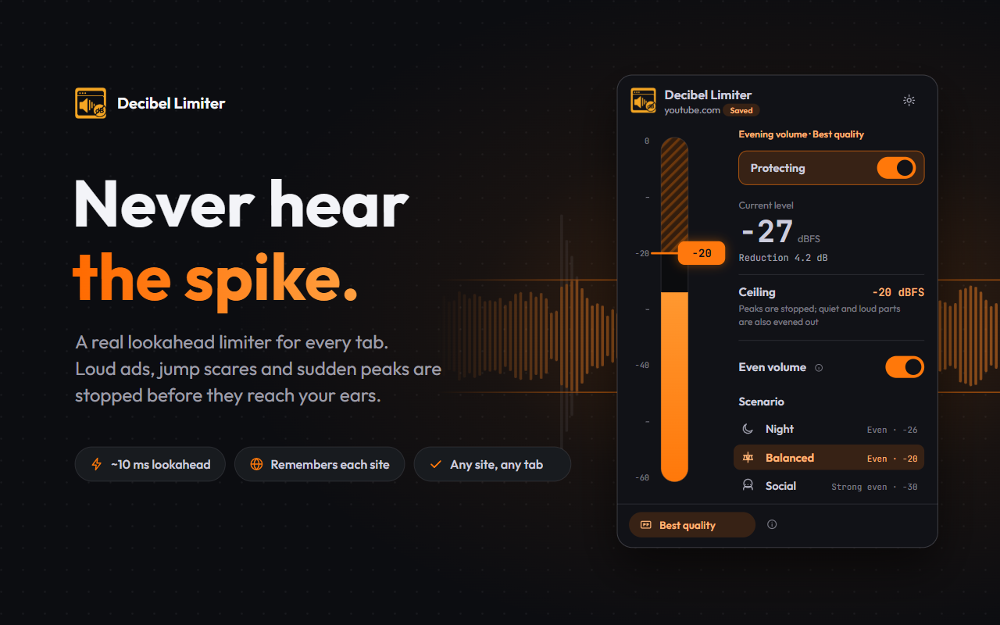
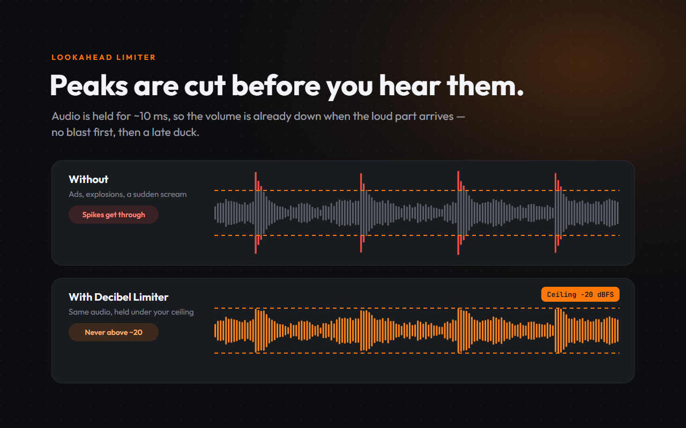
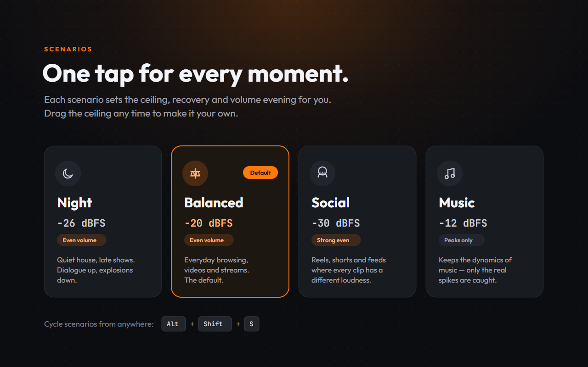
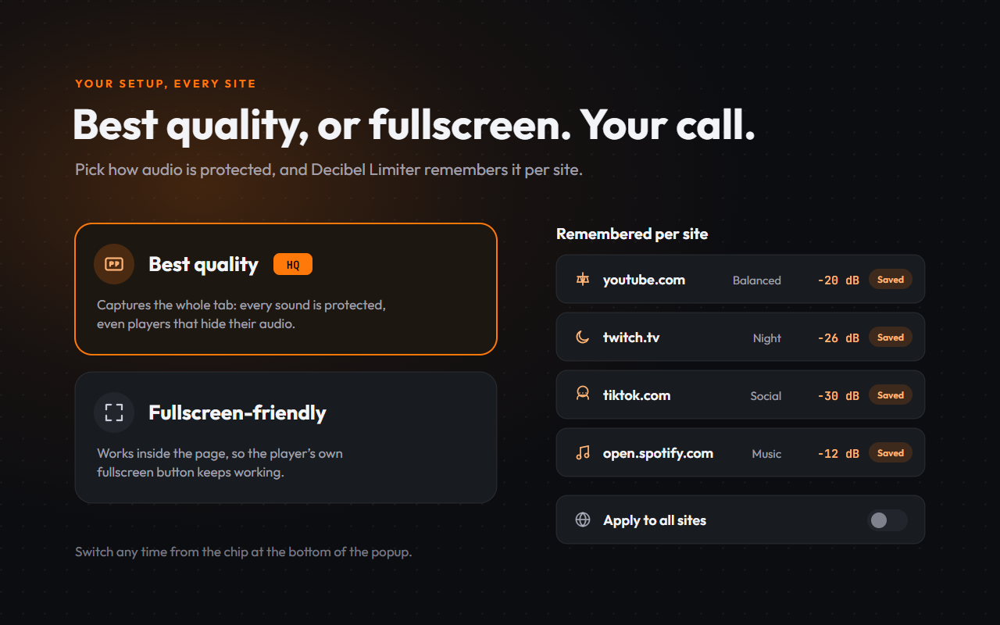

<div align="center">


# Decibel Limiter

**Never hear the spike.** A real lookahead limiter for every browser tab: loud ads, jump scares and sudden peaks
are stopped *before* they reach your ears.

[](https://chromewebstore.google.com/detail/decibel-limiter/jhdflfacjalpcajleapijmclnbilnjlh)
[](https://chromewebstore.google.com/detail/decibel-limiter/jhdflfacjalpcajleapijmclnbilnjlh)
[](https://addons.mozilla.org/firefox/addon/decibel-limiter/)
[](https://github.com/Joansitoh/decibel-limiter/actions/workflows/ci.yml)
[](LICENSE)
[](CONTRIBUTING.md)

[Features](#features) · [Install](#install) · [How it works](#how-it-works) · [Privacy](#privacy) · [Contributing](#contributing)



</div>

## Why

Most volume extensions react *after* a sound gets loud, so you still hear the first instant of every spike.
Decibel Limiter delays the audio by about 10 milliseconds, sees the peak coming, and has already turned it down
when it plays. Nothing gets through above the ceiling you set.

Good for headphones, late nights, shared spaces, autoplaying ads, and anyone who'd rather not be startled.

## Features

- **Lookahead brickwall limiter** in an AudioWorklet, on the audio thread. Instant attack, smooth recovery.
- **Scenarios**: Night, Balanced, Social and Music, one tap each. Or drag the ceiling anywhere from −60 to 0 dBFS.
- **Even volume** (optional): evens out quiet and loud parts before the limiter. Off for Music.
- **Two audio paths**:
  - **Best quality** captures the whole tab, so every sound is covered, even players that hide their audio.
  - **Fullscreen-friendly** works inside the page, so the player's own fullscreen button keeps working.
- **Remembers each site**, or applies one setting everywhere.
- **Live meter** with the current level and how much is being reduced.
- **Keyboard shortcuts**: <kbd>Alt</kbd>+<kbd>Shift</kbd>+<kbd>D</kbd> toggles protection,
  <kbd>Alt</kbd>+<kbd>Shift</kbd>+<kbd>S</kbd> cycles scenarios (change them in your browser's shortcut settings).
- **Export and import** settings, light and dark theme, English and Spanish.

<div align="center">





</div>

## Install

| Browser | Get it | Notes |
|---|---|---|
| Chrome, Edge, Brave, Opera, Vivaldi… (Chromium 116+) | [Chrome Web Store](https://chromewebstore.google.com/detail/decibel-limiter/jhdflfacjalpcajleapijmclnbilnjlh) | Both audio paths |
| Firefox 140+ | [Firefox Add-ons](https://addons.mozilla.org/firefox/addon/decibel-limiter/) | Fullscreen-friendly path only: Firefox has no tab capture |

To run the latest code from this repository, see [Development setup](CONTRIBUTING.md#development-setup). There is
no build step: load the `extension/` folder as an unpacked extension.

## Usage

1. Click the Decibel Limiter icon in the toolbar.
2. Turn **Protection** on.
3. Pick a scenario, or drag the orange ceiling line on the meter. Peaks above it are stopped.
4. Optionally switch the audio path with the chip at the bottom of the popup.

The badge on the icon shows `HQ` when Best quality is active on the tab and `ON` when it's protected inside the
page. Only one tab at a time can use Best quality; other tabs stay protected in Fullscreen-friendly mode.

| Ceiling | Feels like |
|---|---|
| −10 to −15 dBFS | Light touch, only real spikes are caught (Music: −12) |
| −20 dBFS | Everyday browsing (Balanced) |
| −26 to −30 dBFS | Night, or videos with very loud moments (Night: −26, Social: −30) |
| below −30 dBFS | Very quiet, heavy limiting |

## How it works

```
page or tab audio → Even volume (optional) → lookahead limiter (AudioWorklet) → safety compressor → speakers
```

- **Best quality** uses `chrome.tabCapture` and processes the tab's audio in an offscreen document.
- **Fullscreen-friendly** connects each `<audio>`/`<video>` element on the page (including open shadow DOM and
  elements added later) to the same chain.
- The limiter buffers four 128-sample blocks (about 10.7 ms at 48 kHz). Each block's required gain is known before
  it plays, so attack is instant and the output never exceeds the ceiling.

The full picture (config resolution, the one-tab Best quality rule, messages, Firefox specifics) is in
[docs/ARCHITECTURE.md](docs/ARCHITECTURE.md).

## Privacy

Everything happens in your browser. No analytics, no accounts, no network requests, no remote code. Settings are
stored locally with `chrome.storage` and only leave your computer if you export them yourself.

| Permission | Why it's needed |
|---|---|
| `storage` | Save your settings and per-site memory |
| `activeTab`, `tabCapture`, `offscreen` | Best quality: capture the current tab's audio after you open the popup or use a shortcut, and process it (Chromium only) |
| `downloads` | Export your settings to a file |
| Runs on all sites | Fullscreen-friendly needs to reach audio and video elements on any page. It doesn't read page content |

## Troubleshooting

<details>
<summary><strong>No level on the meter, or no limiting</strong></summary>

- Make sure something is playing and the tab isn't muted.
- Reload the page after installing or updating the extension.
- On Best quality, open the popup on that tab once: the browser only allows tab capture after you invoke the
  extension there. If another tab already has Best quality, this one is protected in Fullscreen-friendly mode.
</details>

<details>
<summary><strong>The player's fullscreen button doesn't work well</strong></summary>

Tab capture can conflict with player fullscreen. Switch that site to **Fullscreen-friendly** with the chip at the
bottom of the popup (it's remembered per site), or use the browser's fullscreen (F11).
</details>

<details>
<summary><strong>Audio sounds squashed or pumps</strong></summary>

Raise the ceiling a few dB, turn off **Even volume**, or try another recovery speed in Settings (Fast comes back
sooner after a peak, Slow is smoother). Very dynamic content at a low ceiling will always be limited hard; that's
the protection working.
</details>

<details>
<summary><strong>It doesn't work on a specific site</strong></summary>

Try the other audio path first. If it still fails, [open a bug report](https://github.com/Joansitoh/decibel-limiter/issues/new/choose)
with the site, your browser and the audio path.
</details>

## Contributing

Bug fixes, site compatibility fixes and translations are very welcome. Please read [CONTRIBUTING.md](CONTRIBUTING.md)
first: it covers setup, tests, the commit style and the policy for **AI-assisted contributions**. Coding agents
should start at [AGENTS.md](AGENTS.md).

- [Architecture](docs/ARCHITECTURE.md) · [Changelog](CHANGELOG.md) · [Security policy](SECURITY.md) ·
  [Code of conduct](CODE_OF_CONDUCT.md)

## License

[MIT](LICENSE). Bundled third-party files (GSAP, fonts) keep their own licenses, listed in
[THIRD_PARTY_NOTICES.md](THIRD_PARTY_NOTICES.md).
